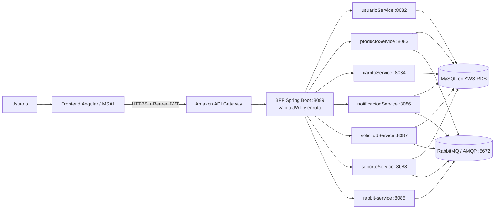

# ⚽ Los FIFAS

Plataforma e-commerce de camisetas de fútbol con personalización, construida con **Angular 21**, **Spring Boot** y microservicios. La infraestructura de aplicación y datos descrita por el proyecto está en AWS.

> **Estado de infraestructura:** este README combina la arquitectura indicada por el código y los scripts disponibles. No hay en este repositorio plantillas IaC (Terraform/CloudFormation/Bicep), Dockerfiles ni `docker-compose.yml`. Los nombres de servicios AWS concretos que no estén definidos por configuración versionada se presentan como arquitectura prevista o por confirmar, no como despliegue reproducible.

---

## 📐 Arquitectura



El frontend inicia sesión con el proveedor de identidad configurado y obtiene un JWT. Envía ese token como `Authorization: Bearer ...` al endpoint de API Gateway configurado en `frontend/src/environment/environment.ts`. El BFF funciona como **Backend for Frontend (BFF)**: valida el JWT y reenvía solicitudes a los servicios internos. El código del BFF contiene direcciones de servicios en una red privada AWS (`172.31.x.x`), por lo que el despliegue requiere conectividad entre esas instancias.

### Infraestructura AWS

Según las capturas de la consola AWS en `us-east-1` (N. Virginia), el entorno tiene:

- **Amazon EC2:** cuatro instancias en ejecución, todas tipo `t3.micro`: `My BFF`, `My MC`, `MyRabbit` y `My MC2`. La captura muestra las instancias distribuidas entre las zonas `us-east-1a` y `us-east-1b`. `MyRabbit` tiene IP privada `172.31.16.142`; en esa instancia se ve ejecutándose `rabbit-service-0.0.1-SNAPSHOT.jar`.
- **Amazon VPC:** una VPC disponible, ID `vpc-09267be7706ab4133`, con seis subredes. Los servicios se comunican mediante direcciones privadas dentro de la red.
- **Grupos de seguridad:** se observan `default`, `sg_rds` y `sg_ec2`, asociados a la VPC. Las capturas no muestran sus reglas de entrada/salida.
- **Amazon RDS:** instancia `fifas-db`, estado disponible, motor MySQL Community, clase `db.t3.micro`, en `us-east-1a`. La puerta de enlace a Internet aparece desactivada.
- **API Gateway:** el frontend tiene configurada una URL de API Gateway en `us-east-1`. No se utiliza un balanceador de carga.
- **RabbitMQ:** la consola indica RabbitMQ 4.2.9 y un clúster con dos nodos: `rabbit@bb468ac5f491` y `rabbit@rabbitmq-2`. La instancia `MyRabbit` aloja el servicio productor; confirma dónde corre el segundo nodo RabbitMQ si necesitas detallar el mapeo entre nodos e instancias.

`start-mc2.sh` arranca los JAR de `productoService`, `usuarioService` y `carritoService` en EC2, usando variables de conexión a RDS. El script no crea EC2, RDS, VPC ni reglas de red. No se encontró infraestructura como código ni archivos Docker Compose en este repositorio.

**Recorrido de red:** Angular llama por HTTPS al endpoint de API Gateway; este reenvía al BFF. El BFF invoca los microservicios en las EC2. Los servicios acceden a RDS MySQL y los productores/consumidores se conectan a RabbitMQ mediante AMQP en el puerto `5672`. No se muestra un balanceador en el entorno.

### RabbitMQ y procesamiento asíncrono

Los productores publican eventos en `eventos_exchange`; los servicios consumidores escuchan sus colas. El código de `backend/rabbit-service/.../RabbitMQConfig.java` declara un exchange `direct`, cuatro colas principales (`notificaciones_queue`, `soporte_queue`, `solicitudes_queue`, `producto_queue`) y cuatro DLQ. Las colas principales usan `eventos_dlx` para enrutar los mensajes rechazados a la DLQ correspondiente. Los listeners implementan ACK/NACK manual.

La configuración de RabbitMQ referencia la dirección privada `172.31.16.142:5672` en varios servicios y el `rabbit-service` usa `localhost:5672` como valor local. Externaliza host, puerto, usuario y contraseña por variables de entorno para que local y cloud no dependan de valores codificados. La consola muestra un clúster RabbitMQ de dos nodos. No se encontró `docker-compose.yml` en este repositorio; documenta el comando o la forma en que se levantaron los nodos si es parte del procedimiento de despliegue. La topología versionada declara exchanges `direct`.

### Flujo ejemplo: compra y notificación

1. El usuario inicia sesión con el proveedor de identidad configurado y el frontend obtiene un JWT.
2. Angular llama la URL de API Gateway configurada con el token Bearer.
3. El BFF valida el token y enruta la solicitud al microservicio correspondiente.
4. Un productor publica un evento en RabbitMQ con exchange y routing key.
5. RabbitMQ aplica el binding y entrega el evento a la cola correspondiente.
6. El `@RabbitListener` valida y procesa el evento. Confirma con ACK al terminar; en los casos codificados, NACK sin requeue deriva mensajes inválidos o fallidos a la DLQ.
7. El servicio puede publicar otro evento para que otro dominio complete una tarea, manteniendo los servicios desacoplados.

---

## 🗂️ Estructura del Proyecto

```
fifas/
├── frontend/                   # Angular 21 SPA
│   ├── src/
│   │   ├── app/
│   │   │   ├── core/           # Guards, interceptors, layout, auth, models
│   │   │   ├── features/       # Módulos funcionales
│   │   │   │   ├── auth/       # Login / registro (MSAL)
│   │   │   │   ├── home/       # Landing page
│   │   │   │   ├── catalog/    # Catálogo + detalle de producto
│   │   │   │   ├── custom-jersey/ # Personalización de camisetas
│   │   │   │   ├── cart/       # Carrito de compras
│   │   │   │   ├── profile/    # Perfil de usuario
│   │   │   │   ├── transactions/ # Historial de transacciones
│   │   │   │   ├── notifications/ # Centro de notificaciones
│   │   │   │   └── support/    # Soporte / chat
│   │   │   └── share/          # Componentes y utilidades compartidas
│   │   └── environment/        # Configuración de entorno
│   ├── angular.json
│   ├── package.json
│   └── tsconfig.json
│
├── backend/
│   ├── bff/                    # Backend For Frontend – Proxy central (:8089)
│   ├── usuarioService/         # Gestión de usuarios y perfiles (:8082)
│   ├── productoService/        # Catálogo de productos (:8083)
│   ├── carritoService/         # Carrito de compras (:8084)
│   ├── notificacionService/    # Notificaciones (:8086)
│   ├── solicitudService/       # Solicitudes / órdenes (:8087)
│   ├── soporteService/         # Mensajes de soporte/chat (:8088)
│   └── rabbit-service/         # Publicación de eventos e inicialización de topología (:8085)
│
└── start-mc2.sh                # Script para levantar servicios en EC2
```

---

## 🛠️ Tech Stack

| Capa | Tecnología |
|---|---|
| **Frontend** | Angular 21, TypeScript 5.9, TailwindCSS 4, RxJS 7.8 |
| **Autenticación** | OAuth 2.0 / OpenID Connect con MSAL Angular 6 + MSAL Browser 5 |
| **BFF** | Spring Boot 4.1, WebFlux (`WebClient`), OAuth2 Resource Server |
| **Microservicios** | Spring Boot 3.2.5, Spring Data JPA, Bean Validation |
| **Mensajería** | Spring AMQP / RabbitMQ – `rabbit-service` y listeners de dominio |
| **Base de datos** | MySQL (AWS RDS) · H2 para tests |
| **Infraestructura** | AWS (API Gateway, EC2, VPC, subredes y RDS MySQL) |
| **Seguridad API** | OAuth 2.0 / OpenID Connect, JWT |
| **Java** | JDK 17 |
| **Build tools** | Maven 3.9+ (backend) · npm 11 (frontend) |
| **Testing** | Vitest 4 (frontend) · JUnit 5 + Spring Security Test (backend) |
| **Code quality** | Prettier (frontend) |

---

## 🚀 Inicio Rápido

### Prerrequisitos

- **Node.js** ≥ 20 y **npm** ≥ 11
- **JDK 17**
- **Maven** 3.9+ (o usar el wrapper `./mvnw` incluido en cada servicio)
- **MySQL** 8+ (o acceso a la instancia RDS)
- **RabbitMQ** (requerido por `rabbit-service` y los consumidores)

### Frontend

```bash
cd frontend
npm install
npm start
```

La app se levanta en `http://localhost:4200`.

### Backend (cada microservicio)

Cada servicio se ejecuta de forma independiente. Ejemplo con `productoService`:

```bash
cd backend/productoService
./mvnw spring-boot:run
```

#### Variables de entorno requeridas por servicio

| Variable | Descripción | Ejemplo |
|---|---|---|
| `*_DB_URL` | URL JDBC de la base de datos | `jdbc:mysql://host:3306/erp_cloud?useSSL=true` |
| `*_DB_USERNAME` | Usuario de la DB | `app_productos` |
| `*_DB_PASSWORD` | Contraseña de la DB | *(secreto)* |
| `AZURE_ISSUER_URI` | URI del emisor de tokens Azure AD | `https://login.microsoftonline.com/{tenant}/v2.0` |
| `AZURE_API_AUDIENCE` | Client ID de la API en Azure | `4974cb3b-...` |
| `SPRING_RABBITMQ_HOST` | Host de RabbitMQ | `localhost` en local |
| `SPRING_RABBITMQ_PORT` | Puerto AMQP | `5672` |
| `SPRING_RABBITMQ_USERNAME` | Usuario AMQP | *(configuración segura)* |
| `SPRING_RABBITMQ_PASSWORD` | Contraseña AMQP | *(secreto)* |

> No guardes contraseñas, claves ni tokens en el repositorio. Hay valores de RabbitMQ escritos directamente en algunos `application.properties`; reemplázalos por variables de entorno antes de publicar o reutilizar credenciales.

### BFF

```bash
cd backend/bff
./mvnw spring-boot:run
```

El BFF escucha en el puerto **8089** y enruta solicitudes `/api/{servicio}/**` a los servicios configurados en `ProxyController`. Revisa esa clase para conocer las rutas y métodos HTTP habilitados.

### Rabbit Service

```bash
cd backend/rabbit-service
./mvnw spring-boot:run
```

Gestiona la mensajería asíncrona entre servicios a través de **RabbitMQ (AMQP)**. Expone `POST /api/rabbit/eventos/{routingKey}` en el puerto **8085** para publicar eventos. AMQP usa el puerto **5672**.

### Script de despliegue rápido (EC2)

El archivo [`start-mc2.sh`](start-mc2.sh) arranca en paralelo los servicios principales (`productoService`, `usuarioService`, `carritoService`) directamente desde los JARs compilados, configurando las variables de conexión a AWS RDS. Requiere que los JAR y comandos que utiliza ya existan en la instancia.

```bash
source start-mc2.sh
```

---

## 🔐 Autenticación

El flujo de autenticación utiliza **Microsoft Identity Platform (Azure AD)**:

1. El usuario inicia sesión en el proveedor de identidad configurado a través de **MSAL Redirect Flow**.
2. El frontend obtiene un token JWT con el scope `api://{clientId}/access_as_user`.
3. El interceptor HTTP (`apiAuthInterceptor`) adjunta el token `Bearer` a cada petición al BFF.
4. El BFF y cada microservicio validan el JWT como **OAuth2 Resource Server**.

---

## 🧪 Tests

### Frontend

```bash
cd frontend
npm test
```

Utiliza **Vitest 4** como test runner.

### Backend

```bash
cd backend/<servicio>
./mvnw test
```

Los tests del backend usan **H2 en memoria** para no depender de MySQL.

---

## 📡 Puertos por Servicio

| Servicio | Puerto |
|---|---|
| Frontend (dev server) | `4200` |
| BFF | `8089` |
| usuarioService | `8082` |
| productoService | `8083` |
| carritoService | `8084` |
| notificacionService | `8086` |
| solicitudService | `8087` |
| soporteService | `8088` |
| rabbit-service HTTP | `8085` |
| RabbitMQ AMQP | `5672` |
| RabbitMQ Management UI | `15672` si el plugin está habilitado; no se configura en este repositorio |

---

## 👥 Equipo

Proyecto académico — **DUOC UC**.

---

## 📄 Licencia

Uso académico. Todos los derechos reservados.
